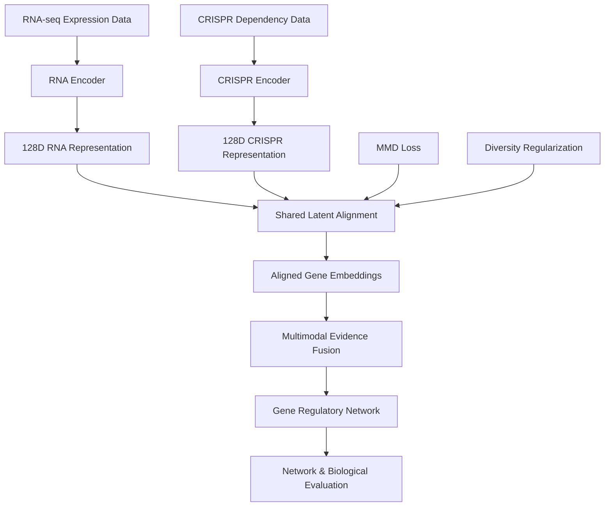
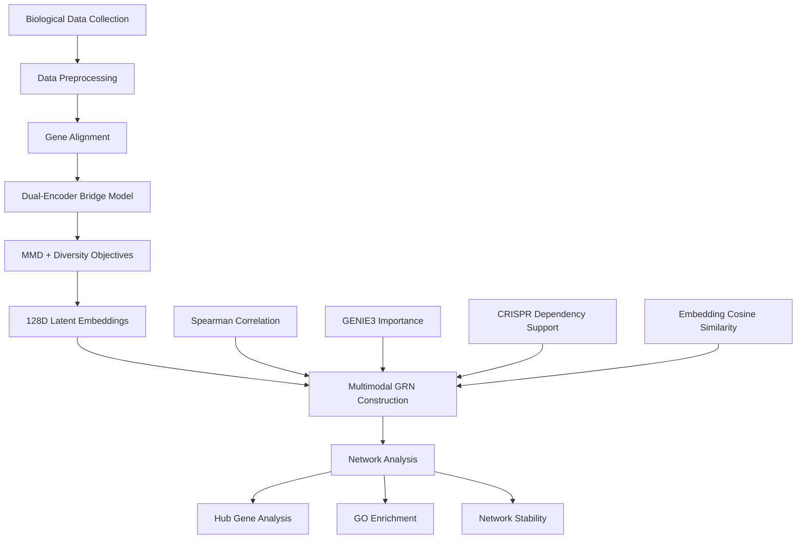

<div align="center">

<picture>
  <source
    media="(prefers-color-scheme: dark)"
    srcset="https://readme-typing-svg.demolab.com?font=Fira+Code&weight=700&size=25&duration=3000&pause=1000&color=36BCF7&center=true&vCenter=true&width=950&lines=Multimodal+Bridge+Framework;Gene+Regulatory+Network+Discovery;Deep+Learning+%7C+Bioinformatics"
  />
  <source
    media="(prefers-color-scheme: light)"
    srcset="https://readme-typing-svg.demolab.com?font=Fira+Code&weight=700&size=25&duration=3000&pause=1000&color=1764A0&center=true&vCenter=true&width=950&lines=Multimodal+Bridge+Framework;Gene+Regulatory+Network+Discovery;Deep+Learning+%7C+Bioinformatics"
  />
  
</picture>

### 🧬 Multimodal Bridge Framework for Gene Regulatory Network Discovery

**Generalized Bridge Pipeline for Multimodal Gene Regulatory Network Discovery**

*Deep Learning • Computational Biology • Multimodal Integration • Network Inference*

<br/>


<br/>


</div>

---

## 📖 Research Overview

Gene Regulatory Networks (GRNs) describe
relationships among genes and help researchers
investigate the mechanisms controlling
gene expression and cellular functions.

Traditional computational GRN inference
methods frequently rely on gene expression
measurements alone.

However, expression-based associations
do not necessarily capture functional
dependencies or experimentally supported
regulatory relationships.

**Multimodal Bridge Framework for Gene
Regulatory Network Discovery** investigates
a generalized computational approach
for integrating complementary biological
data modalities.

The framework combines:

- RNA sequencing expression data
- CRISPR knockout dependency profiles
- Deep neural network-based representation learning
- Maximum Mean Discrepancy (MMD) alignment
- Diversity-preserving regularization
- Spearman correlation
- GENIE3 regulatory importance
- Embedding cosine similarity
- Biological network analysis

The objective is to construct
more informative and interpretable
gene regulatory networks by combining
transcriptomic and functional evidence.

This research was conducted as an
undergraduate thesis at **BRAC University**.

> [!NOTE]
> This repository currently contains
> the original thesis report and README.
> The research implementation, datasets,
> and model files are not yet included.
>
> The methodology and findings below
> are documented from the thesis report.

---

## 🎯 Research Objectives

The primary objectives of this thesis are:

1. Develop a generalized computational
   pipeline for multimodal GRN discovery.

2. Integrate RNA-seq expression and
   CRISPR knockout dependency data.

3. Learn a shared latent representation
   through a dual-encoder neural network.

4. Align heterogeneous biological
   modalities using MMD-based learning.

5. Preserve biologically meaningful
   variation during representation learning.

6. Construct regulatory networks using
   complementary statistical and
   functional evidence.

7. Evaluate network consistency,
   biological relevance, and interpretability.

8. Investigate the framework across
   hematopoietic and lung cell contexts.

---

## 🧬 Biological Data Modalities

The framework integrates two
complementary sources of biological
information.

### 1. RNA Sequencing Data

RNA sequencing provides measurements
of gene expression.

The thesis uses transcriptomic
information to investigate:

- Gene expression patterns
- Co-expression relationships
- Regulatory associations
- Gene-level statistical dependencies

Expression information is used in
correlation analysis and
GENIE3-based network inference.

### 2. CRISPR Knockout Dependency Data

CRISPR knockout screening provides
functional evidence about the
importance of genes to cellular viability.

The framework uses dependency profiles
to incorporate functional information
into the regulatory network
construction process.

These measurements complement
RNA-seq data by providing
additional biological evidence.

### Why Combine Them?

| RNA-seq | CRISPR |
|:---|:---|
| Measures gene expression | Measures functional dependency |
| Supports co-expression analysis | Supports gene essentiality analysis |
| Provides transcriptomic relationships | Provides perturbation-based evidence |
| Supports statistical inference | Adds functional context |

By integrating both modalities,
the framework aims to identify
regulatory relationships supported
by multiple sources of evidence.

---

## 🏗️ Bridge Framework Architecture

The proposed framework uses a
**dual-encoder neural network**
to process RNA-seq and CRISPR
features separately.

Each encoder projects its input
into a shared:

**128-dimensional latent space**

The learned representations are
aligned using Maximum Mean
Discrepancy while preserving
important biological variation.

### Architecture Overview



### Key Architecture Components

<details>
<summary><b>🧠 Dual-Encoder Representation Learning</b></summary>

<br/>

The framework uses separate encoders
for the two biological modalities.

Each encoder transforms
high-dimensional biological
features into a common
128-dimensional representation.

The shared space is intended
to capture complementary
transcriptomic and functional
information.

</details>

<details>
<summary><b>🔗 Maximum Mean Discrepancy</b></summary>

<br/>

Maximum Mean Discrepancy (MMD)
is used to encourage alignment
between the RNA-seq and CRISPR
latent representations.

This helps reduce differences
between their learned
feature distributions.

The objective is to bring
the two modalities into
a more compatible
representation space.

</details>

<details>
<summary><b>🧬 Diversity-Preserving Regularization</b></summary>

<br/>

The framework also includes
a diversity-preserving
regularization objective.

This component helps retain
meaningful biological variation
rather than allowing the
aligned embeddings to collapse
into uninformative representations.

The combination of alignment
and diversity objectives
supports the learning of
structured gene representations.

</details>

---

## 🔄 Research Methodology

The overall methodology follows
a multimodal data integration
and network inference pipeline.



### Methodology Stages

| Stage | Description |
|:---|:---|
| Data preparation | Process transcriptomic and CRISPR measurements |
| Gene alignment | Identify compatible gene representations |
| Bridge learning | Train modality-specific encoders |
| Latent alignment | Apply MMD and diversity objectives |
| Evidence fusion | Combine statistical and functional signals |
| GRN inference | Construct weighted regulatory networks |
| Network evaluation | Examine topology and hub consistency |
| Biological evaluation | Investigate functional support and GO enrichment |

---

## 🕸️ Gene Regulatory Network Inference

The thesis combines four
complementary evidence sources
for network construction.

### 1. Spearman Correlation

Spearman correlation measures
monotonic relationships between
gene expression profiles.

It provides evidence of
co-expression relationships.

### 2. GENIE3 Importance

GENIE3 uses tree-based
machine learning to infer
regulatory relationships
from gene expression data.

The framework incorporates
GENIE3 feature-importance
scores into network inference.

### 3. CRISPR Dependency Support

CRISPR dependency information
provides additional functional
evidence about genes.

This supports interpretation
of network relationships
beyond expression data alone.

### 4. Embedding Cosine Similarity

Cosine similarity measures
relationships between genes
in the learned latent space.

It provides a representation-based
measure of gene similarity.

### Multimodal Evidence Integration

The framework combines these
signals into a unified
edge-weighting strategy.

The resulting network
incorporates statistical,
predictive, functional,
and embedding-based evidence.

---

## 🧪 Experimental Settings

The research evaluates the
framework in two biological contexts.

### Hematopoietic Data

The hematopoietic experiments
investigate gene regulatory
relationships associated with
blood-cell-related biological
systems.

The thesis includes:

- RNA-only network analysis
- Bridge-fused network analysis
- Hub gene investigation
- Functional dependency evaluation
- Gene Ontology enrichment

### Lung Data

The lung experiments investigate
the same framework in
lung-related cellular systems.

The thesis evaluates:

- Multimodal representation alignment
- Network construction
- Hub gene consistency
- Network overlap
- Functional relevance
- Biological enrichment

Using both contexts allows
the thesis to investigate
whether the proposed framework
can be applied across
different biological settings.

---

## 📊 Research Findings

The thesis reports that the
Bridge framework produces
structurally consistent
and biologically interpretable
gene regulatory networks.

### Network Consistency

| Evaluation Metric | Hematopoietic | Lung |
|:---|---:|---:|
| Jaccard Similarity | 0.981 | 0.979 |
| Kendall's Hub Rank Correlation | 1.000 | 0.955 |
| Mean CRISPR Support z-score (Top Hubs) | -0.121 | -0.393 |

These values are reported
in the thesis conclusion.

### Interpretation

**Jaccard Similarity**

The reported Jaccard scores
indicate substantial overlap
between compared network
edge sets.

**Hub Rank Consistency**

The Kendall's correlation
results indicate high
consistency in the ranking
of important network hubs.

**CRISPR Functional Support**

Negative mean dependency
scores among top hubs
provide supporting evidence
that some identified
regulators have important
functional roles.

### Representation Alignment

The thesis reports an
improvement in cross-modal
cosine similarity:

| Representation | Approximate Cosine Similarity |
|:---|---:|
| Before Bridge Alignment | 0.6 |
| After Bridge Alignment | 0.9 |

These results suggest
improved alignment between
the learned representations.

### Network Topology

The inferred networks
also exhibited:

- Clustering coefficients near 0.3
- Average path lengths of approximately 4–5
- Power-law degree exponents around 2–2.5

The thesis interprets these
characteristics as consistent
with structural properties
often observed in
biological networks.

> [!IMPORTANT]
> These are findings reported
> in the thesis document.
> They have not been independently
> reproduced from source code
> in this repository.

---

## 🧬 Biological Interpretation

### Hub Gene Analysis

The thesis investigates
important regulatory hubs
within the inferred networks.

Examples discussed include:

- `HLA-DRA`
- `EEF2`
- `ABLIM1`

The analysis also discusses
mitochondrial-related regulators
in the lung context.

These genes are examined
in relation to their
biological roles and
functional importance.

### Gene Ontology Enrichment

Gene Ontology enrichment
analysis is used to investigate
whether identified genes
and network modules correspond
to meaningful biological processes.

The thesis reports enrichment
associated with:

- Immune activation
- Antigen presentation
- RNA translation
- Mitochondrial function
- Metabolic processes

These findings support
the biological interpretation
of the inferred networks.

---

## 🔬 Research Contributions

The thesis presents several
research contributions.

### Multimodal Integration

A unified framework for
combining transcriptomic
expression measurements
with CRISPR functional data.

### Shared Representation Learning

A dual-encoder Bridge model
that projects heterogeneous
features into a shared
128-dimensional latent space.

### Distribution Alignment

An MMD-based objective
to encourage cross-modal
representation alignment.

### Diversity Preservation

A regularization strategy
designed to retain meaningful
variation in gene embeddings.

### Evidence-Based GRN Construction

A network inference approach
combining multiple statistical,
functional, and learned
representation signals.

### Cross-Context Evaluation

Application of the framework
to hematopoietic and lung
biological datasets.

### Biological Interpretability

Evaluation through network
topology, hub gene analysis,
CRISPR dependency support,
and Gene Ontology enrichment.

---

## ⚠️ Research Limitations

The thesis findings should
be interpreted in the context
of computational biological
network inference.

### Computational Inference

The inferred regulatory edges
represent model-based predictions
and associations.

They do not independently
establish direct causal
regulatory relationships.

### Experimental Validation

The thesis identifies
experimental perturbation
studies as an important
direction for validating
predicted edges and hub genes.

### Data Integration

Differences in biological
data sources, gene naming,
and measurement characteristics
can affect multimodal alignment.

### Generalization

Although the framework
was evaluated in two
biological contexts,
broader testing would be
needed to establish
performance across
additional tissues
and experimental settings.

### Therapeutic Interpretation

Potential therapeutic relevance
remains a research hypothesis,
not a clinically validated
treatment finding.

---

## 📂 Repository Structure

The repository currently
contains the thesis report
and project documentation.

```text id="bridgestructure"
Multimodal-Bridge-Framework-for-Gene-Regulatory-Network-Discovery/
│
├── README.md
│
└── T2430497_Final Thesis Report.pdf
```

### Available Files

| File | Description |
|:---|:---|
| `README.md` | Research overview, methodology, results, and documentation |
| `T2430497_Final Thesis Report.pdf` | Complete undergraduate thesis report |

### 📄 Full Thesis Report

The complete report contains:

- Introduction
- Literature Review
- Methodology
- Implementation and Experimental Analysis
- Result Analysis
- Conclusion
- Bibliography

**[Read the Full Thesis Report](T2430497_Final%20Thesis%20Report.pdf)**

> The implementation files
> and datasets are not currently
> included in this repository.
> This README documents the
> completed research report.

---

## 🎓 Academic Information

**Thesis Title:**

Generalized Bridge Pipeline for
Multimodal Gene Regulatory
Network Discovery

**Institution:** BRAC University

**Department:** Computer Science and Engineering

**Degree:** Bachelor of Science in Computer Science

**Thesis Completion:** October 2025

### Research Supervisors

**Supervisor**

Dr. Md. Golam Rabiul Alam  
Professor  
Department of Computer Science and Engineering  
BRAC University

**Co-Supervisor**

Dr. Swakkhar Shatabda  
Professor  
Department of Computer Science and Engineering  
BRAC University

---

## 👥 Research Contributors

| Student ID | Researcher |
|:---:|:---|
| 24141153 | Abrar Sami Khan Alif |
| 21201205 | Riyadus Salehin Fahmid |
| 21141058 | Mohammad Omar Raihan |
| 23241085 | Omor Bin Amjad Chowdhury |

**Research Type:** Undergraduate Thesis

**Institution:** BRAC University

---

## 📚 Research Background

The thesis builds upon
established concepts
in computational biology
and network inference.

Relevant research areas include:

- Gene regulatory network inference
- Transcriptomics
- CRISPR functional genomics
- Deep representation learning
- Multimodal data integration
- Distribution alignment
- Network biology
- Gene Ontology enrichment

The full thesis report
contains the detailed
bibliography and citations
supporting the research.

---

## 📌 Research and Ethical Considerations

This repository documents
computational research
in gene regulatory
network discovery.

The inferred networks
are intended to support
biological investigation
and hypothesis generation.

They should not be treated
as experimentally confirmed
causal networks or
clinically validated
therapeutic recommendations.

---

<div align="center">

### 🧬 Bridging Transcriptomics and Functional Genomics

*Multimodal Representation Learning for Interpretable Gene Regulatory Networks*

**Undergraduate Thesis | BRAC University | 2025**

<br/>


</div>
